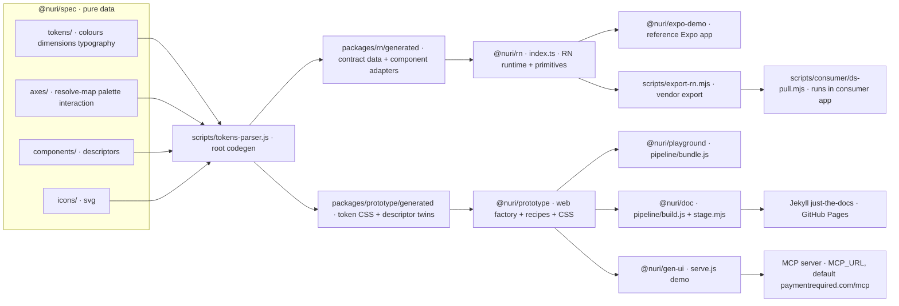
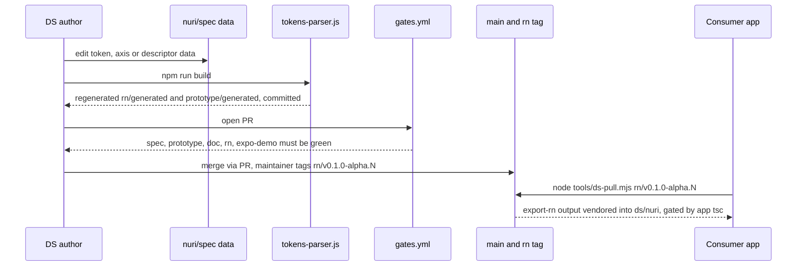

# Nuri Design System

A mobile-first design system for Expo and React Native. RN is the production target; the web side is a prototyping and documentation surface, not a co-equal platform.
One source of data (`@nuri/spec`) drives every target: a token, axis or component is authored once and each target's output is generated from it.
For Nuri app teams that consume `@nuri/rn` and for DS maintainers.

## Logs

- [CHANGELOG.md](./CHANGELOG.md): release notes and commit history
- [PROMPTLOG.md](./PROMPTLOG.md): prompts and rules given by the owner

The *why* behind past decisions lives in the historical archive ([`decisionlog.md`](./decisionlog.md), [`roadmap/`](./roadmap/)). You rarely need it; this doc plus the code are the source of truth.

## Status

| Field | Value |
|---|---|
| Version | `rn/v0.1.0-alpha.15` (latest tag, on `66d31d6`; HEAD adds only `prompts/` handoff docs). Workspace `package.json` versions are `0.0.1` (expo-demo `1.0.0`), all `private`. |
| Date | 2026-10-14 |
| Updated by | hermes-agent for emino |
| Default branch HEAD | `main` @ `d6f153a` |
| Docs site | GitHub Pages via [`.github/workflows/pages.yml`](./.github/workflows/pages.yml) on push to `main`: https://nuri-com.github.io/nuri-design-system/ |
| RN distribution | No npm registry. Consumers vendor `@nuri/rn` from a git tag `rn/v0.1.0-alpha.N` via [`scripts/consumer/ds-pull.mjs`](./scripts/consumer/ds-pull.mjs) and [`scripts/export-rn.mjs`](./scripts/export-rn.mjs). |
| CI | [`.github/workflows/gates.yml`](./.github/workflows/gates.yml): 5 required jobs `spec`, `prototype`, `doc`, `rn`, `expo-demo` |

## The one rule

> **Data lives once, in `@nuri/spec`. Logic and generated output live in the projection that runs them.**

`@nuri/spec` is **pure data**: no code, no dependencies, no generated artifacts. Every consumer is a **projection** that resolves spec's data into the form it needs and owns that resolution.

## Architecture



### The shape

```
@nuri/spec          PURE DATA, the source of truth
  tokens/           dimensions · colours · typography        (the token SoTs)
  axes/             resolve-map · palette-surface · interactive-effects ·
                    typography-axis · property-spelling · interaction
  components/       alert · bottom-sheet-chrome · button · icon-avatar · icon-button ·
                    list · list-action · list-switch · modal-panel · schema ·
                    select-field · select-trigger · switch · tab-bar · tab-bar-item ·
                    text-field · topbar                       (descriptors)
  icons/            *.svg                                     (the icon SoT)

@nuri/rn            PRODUCTION, the RN projection
  generated/        the resolved contract, flattened from spec at build · committed
    data/           the data tables (tokens · palette · recipes · icons ·
                    interaction · token-paths)
    components/     the per-descriptor API adapters
  contract.ts       imports ./generated/data/*
  runtime/          the INTERNAL engine: resolve · renderer · theme-payload builder
  primitives/       the open primitive layer (View/Text/Pressable/Image/Screen/Scroll · NuriIcon ...)
  theme.tsx         NuriThemeProvider / NuriScope / the resolved theme payload
  toast.tsx         ToastProvider / useToast · imperative overlay tenant

@nuri/prototype     the WEB projection (prototyping + the doc surface's components)
  generated/        the token CSS · descriptor .js twins · token-vars · icon registry
  factory · recipes · primitives

@nuri/doc           the documentation site (just-the-docs, GitHub Pages, live off main).
                    Generates component/foundation Markdown from spec DATA + the projections.

@nuri/playground    the local bench (pages/*.html)
@nuri/gen-ui        generative UI experiment: MCP tool schema/response to Nuri UI
scripts/            the codegen: reads spec's TS SoTs, writes each projection's generated/ output
```

### How resolution works

- **Build time resolves everything resolvable; runtime selects only the context variant.** Box, stack, typography, interactive are 100% static. Only **colour** varies by context.
- **Colour is layered substitution, not a cross-product.** `accent` is *upstream* (it fills the accent portion of the palette); `mode` (light/dark) is *downstream* (resolves the variant across the composed palette). chrome is stored once (theme-only `{light,dark}`); each accent is one object (roles flat where mode-invariant, `{light,dark}` where they adapt). The provider **composes** `(accent, mode)` at selection time; there is no materialized `(accent x theme)` table.
- **The RN provider is a contract, opt-in.** Default is a static resolved slice (zero runtime, max perf). Opt-in is runtime `(accent, mode)` switching (Unistyles is the intended backing, *behind* the contract, never leaked). `accent` is a runtime-capable selection axis (latent: semantic accents, e.g. a `crypto`/`fiat` toggle).
- **Two projections, one SoT:** web composes via the CSS cascade (`[data-accent]` x `[data-theme]`, the browser resolves); RN composes via the provider (refs flattened to hex at build).

## User flow

How a DS change reaches a consumer app:



## Components

| Component | Path | Role |
|---|---|---|
| `@nuri/spec` | `packages/spec/` | Pure data SoT: `tokens/`, `axes/`, `components/` (descriptors), `icons/`, `composition/`. Exposed via `package.json` `exports`. |
| Codegen | `scripts/tokens-parser.js`, `scripts/parsers/` | Reads spec TS SoTs, writes `packages/rn/generated/` and `packages/prototype/generated/`. |
| Drift guards | `scripts/*.test.js` | Node test suite for the token pipeline (root `npm test`). |
| RN exporter | `scripts/export-rn.mjs` | Flattens `@nuri/rn` plus its spec imports into one self-contained TS tree for vendoring. |
| Consumer pull | `scripts/consumer/ds-pull.mjs` | Copied into consumer apps as `tools/ds-pull.mjs`; clones a DS tag, runs the exporter, swaps `ds/nuri`, gates on `tsc`. |
| `@nuri/rn` | `packages/rn/` | Production RN projection. Entry `index.ts`. `theme.tsx`, `root.tsx`, `overlay.tsx`, `toast.tsx`, `safe-area.tsx`, `runtime/`, `primitives/`, `generated/`. |
| `@nuri/expo-demo` | `packages/expo-demo/` | Reference Expo app consuming `@nuri/rn`. Entry `index.ts` to `App.tsx`. |
| `@nuri/prototype` | `packages/prototype/` | Web projection: `factory/`, `primitives/`, `recipes/`, `styles/`, `generated/`, `legacy/`. |
| `@nuri/playground` | `packages/playground/` | Local web bench: `pages/*.html`, bundled by `pipeline/bundle.js`. |
| `@nuri/doc` | `packages/doc/` | Docs site generator: `pipeline/build.js` emits `generated/` Markdown, `stage.mjs` stages runtime assets, Jekyll builds. |
| `@nuri/gen-ui` | `packages/gen-ui/` | Generative UI experiment: MCP tool schema/response to UI tree to HTML (`mapper.js`, `response-mapper.js`, `renderer.js`, `validator.js`, `catalog.json`, `app/`, `demo/`). |
| Governance | `docs/design-system-admission.md`, `.github/ISSUE_TEMPLATE/` | Admission policy plus maintenance and contract-admission issue forms. |
| Agent guide | `AGENTS.md`, `llms.txt`, `prompts/` | Instructions and handoff notes for agents. |
| History | `decisionlog.md`, `roadmap/`, `docs/archive/` | Immutable historical record. `docs/RISKS.md` is the live risk register. |

## API / Endpoints

### `@nuri/rn` public surface (`packages/rn/index.ts`)

- Runtimes: `NuriRoot`, `NuriThemeProvider`, `NuriScope`, `useNuriTheme`, `typeStyle`, `NuriSafeAreaProvider`, `useNuriSafeAreaInsets`, `OverlayProvider`, `useOverlay`, `ToastProvider`, `useToast`.
- Generated components (`generated/components/`): alert, button, icon-avatar, icon-button, list, list-action, list-switch, modal-panel, select-field, select-trigger, switch, tab-bar, tab-bar-item, text-field, topbar.
- Primitives (`primitives/`) and `NuriIcon`.
- Descriptor data, scale tables, renderer helpers and engine internals are intra-package only.

### `@nuri/gen-ui` demo server (`packages/gen-ui/serve.js`)

| Method | Path | Auth | Purpose |
|---|---|---|---|
| GET | `/` | none | Demo page (`demo/index.html`) |
| GET | `/app` | none | Phone-width app shell (`app/index.html`) |
| GET | `/api/tools` | none | Proxies MCP `tools/list` |
| POST | `/api/call` | none | Body `{name, arguments}`; proxies MCP `tools/call`, returns rendered HTML |
| GET | `/prototype/*`, `/ds/*`, other paths | none | Static files |

Local dev server only. Upstream calls go to the MCP server at `MCP_URL`.

### CLI scripts

| Command | Purpose |
|---|---|
| `node scripts/tokens-parser.js` | Token codegen (root `npm run build`) |
| `node scripts/export-rn.mjs [outDir]` | Export a vendorable RN tree (default `vendor-out/nuri-ds`) |
| `node tools/ds-pull.mjs rn/v0.1.0-alpha.N` | In a consumer app: pin `@nuri/rn` to a tag |
| `node tools/ds-pull.mjs --local ../nuri` | In a consumer app: pull from a local DS checkout |

## Run

Node 20 (as in CI). npm workspaces.

```sh
npm ci
npm run build                       # codegen, then each workspace build
npm test                            # node --test scripts/*.test.js + workspace tests

npm test -w @nuri/rn                # jest render-smoke
npm run typecheck -w @nuri/rn
npm run typecheck -w @nuri/expo-demo
npm run start -w @nuri/expo-demo    # expo start (also: android, ios, web)
npm run build -w @nuri/prototype
npm run build -w @nuri/playground
npm run build -w @nuri/doc
npm run demo -w @nuri/gen-ui        # http://localhost:4173
```

Docs site locally (as in `pages.yml`): `npm run build -w @nuri/doc && node packages/doc/stage.mjs`, then `bundle exec jekyll build` in `packages/doc/`.

Env var names read by the code:

| Name | Where | Purpose |
|---|---|---|
| `MCP_URL` | `packages/gen-ui/` | MCP endpoint, default `https://paymentrequired.com/mcp` |
| `PORT` | `packages/gen-ui/serve.js` | Demo port, default `4173` |
| `NO_OPEN` | `packages/gen-ui/serve.js` | Skip auto-opening the browser |
| `DS_GIT_URL` | `scripts/consumer/ds-pull.mjs` | Override the DS git remote |

### CI gates

- `spec`: codegen + drift guards + re-emit equals committed.
- `prototype`: namespace CSS and playground bundles re-emit equals committed.
- `doc`: doc-gen drift guard + generated Markdown re-emit equals committed.
- `rn`: render-smoke + `tsc`. It imports the contract and renders it, so a contract change that breaks RN fails CI by construction.
- `expo-demo`: `tsc`.

**Discipline:** generated output is never hand-edited. Change the SoT and regenerate; the re-emit gate fails a stale commit. Every change ships on a branch via PR into protected `main`.

## Admission boundary

The design-system repository is the slow shared core. Fast learning normally lives in the consumer repo that owns the product problem; the DS playground/prototype may host bounded DS-owned non-contract experiments, but there is no fast lane for public DS growth. Public/observable shared-core changes follow the [design-system admission policy](./docs/design-system-admission.md) before Project `Ready`/implementation: the requester/consumer provides need, gap, workaround, and available edge evidence, then a named human DS architect independent from the requester/consumer records `Admit`, `Reject`, `Request more evidence`, or `Keep consumer-owned` in an authenticated canonical issue comment or architect-owned linked ADR. A contract is only admitted after that independent decision; the requester/consumer cannot self-admit, and overlapping requester/architect roles require a second named human architectural reviewer. The admitting architect may implement later after independent admission, but independent verification remains required. Before Project `Ready`, the item needs the linked architect-owned decision record, architect-accepted contract, bounded execution scope, and downstream verification plan. Actual Expo/device/runtime/compatibility proof is collected after implementation before Verified/Done. Consumer demand, form completion, branch creation, PRs, Expo demos, implementing agents, labels, or green gates do not confer admission or Ready. Gates prove behavior/drift only, not architecture, ownership, recurrence, or whether a concept belongs in the shared core.

## How to work on it (common tasks)

- **Use the right DS front door:** use the lightweight maintenance form for Corrections, internal maintenance, and bounded non-contract Experiments; use the contract-admission request form for Contractions, Extensions, or Mixed public/observable contract changes. The request form does not admit the contract: an independent named human DS architect records the outcome separately, and Project `Ready`, not a form field or label, is the manual-pilot authorization boundary.
- **Add an accent:** a ramp + one accent object + one `ACCENTS` entry in `tokens/colours.ts`. Data only.
- **Add/edit a token:** edit the SoT in `tokens/` (dimensions · colours · typography), regenerate.
- **Add a component:** author a descriptor in `components/` (a composition of the axis namespaces in semantic names · the factory resolves it on RN, CSS on web). This is the **product work** (the catalog).
- **An axis** (box/stack/palette/interactive/typography) is a data table in `axes/`.

## State

The infrastructure refactor is **complete** (#105 to #126): `@nuri/spec` is pure data, the two projections own their generated output, the colour system is data-driven end to end, the component-API arc landed (#114 to #119 · each descriptor declares its public API and codegen emits exact per-component adapters), and the debt register closed with every entry resolved. **The current work is the product: the catalog**, descriptors for the components still living in `@nuri/prototype/legacy/`, built on that clean foundation, on the principle that *everything is axis composition*. The latest arcs (#223 Switch + ListSwitch, #225 media-card vocabulary) are merged as evidence for pending admission requests, not as admitted contracts.

## Where history lives (you rarely need it)

[`decisionlog.md`](./decisionlog.md) and [`roadmap/`](./roadmap/) are the **immutable historical record**, the *why* behind how things got here. Settled design docs and closed registers (the debt register · the target designs · the consumer feedback · the 2026-06 risk snapshot) live in [`docs/archive/`](./docs/archive/). They are archived: do not cite them operationally (this doc plus the code are current). [`docs/RISKS.md`](./docs/RISKS.md) is the live risk register.
